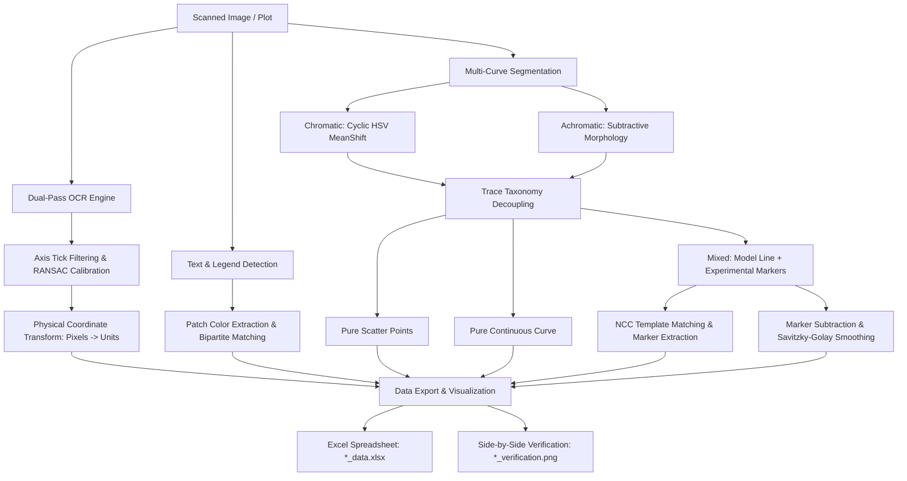

# Automated Experimental Curve Extraction Pipeline

An end-to-end automated computer vision and OCR pipeline in Python designed to extract, calibrate, and digitize scientific plots and experimental curves from scanned figures and publication graphics.

Developed as a Technical Project (2nd Year Engineering Curriculum - Mines Saint-Étienne).

---

## 🌟 Key Highlights

* **100% Fully Automated**: Zero manual intervention. No manual point clicking or hardcoded axis ranges.
* **Intelligent Axis Calibration**:
  * Dual-pass OCR (standard + Otsu binarized) with EasyOCR to detect tick mark values.
  * Robust consensus linear regression (**RANSAC**) with regular step verification to eliminate outlier tick values.
  * Real-unit calibration from pixel coordinates to physical scale ($x, y$).
* **Legend Extraction & Color Matching**:
  * Detects text labels and their adjacent color swatches or marker symbols.
  * Greedy bipartite color matching in RGB Euclidean space between legends and segmented curves.
* **Multi-Curve Segmentation**:
  * **Chromatic curves**: Unsupervised clustering via **MeanShift** on cyclic HSV hue space ($\cos\theta, \sin\theta$) to handle continuous hue wraps.
  * **Achromatic curves**: Subtractive mathematical morphology to extract black/gray curves while eliminating axes, ticks, grid lines, and text.
* **Model vs. Experimental Marker Decoupling**:
  * Differentiates pure scatter plots, pure continuous curves, and mixed curves.
  * For mixed curves (e.g. continuous kinetic model + experimental points):
    * Disconnected marker extraction at onset ($Y=0$).
    * Guided template matching (Normalized Cross-Correlation) to detect markers along the continuous trace.
    * Marker footprint subtraction and boundary-preserving **Savitzky-Golay** smoothing for the continuous model line.
* **Dual Output Generation**:
  * Structured **Excel spreadsheet** (`*_data.xlsx`) with corresponding $X$ and $Y$ columns strictly adjacent.
  * Side-by-side **verification figure** (`*_verification.png`) comparing the original graphic against the reconstructed digitized traces.

---

## 📁 Repository Structure

```text
.
├── main.py                     # Main execution and batch processing script
├── requirements.txt            # Python dependencies and technical specifications
├── README.md                   # Project documentation
├── .gitignore                  # Git ignore rules for Python, cache, and IDEs
│
├── images/                     # Input directory: scanned plots and benchmark figures
│   ├── Curve_points.png
│   ├── Data_points.png
│   ├── image082.png
│   └── test_graph.png
│
├── data/                       # Output directory: extracted spreadsheets and verification plots
│   ├── *_data.xlsx             # Calibrated data tables (adjacent X and Y columns)
│   └── *_verification.png      # Side-by-side visual validation figures
│
├── docs/                       # Technical documentation and detailed reports
│   └── explication_technique.pdf
│
├── presentation/               # Slide decks and generation scripts
│   ├── build_pptx.py           # Automated presentation generator (python-pptx)
│   └── Extraction_automatique_de_courbes_v3.pptx
│
├── scratch/                    # Intermediate test scripts and experimental prototypes
└── archives/                   # Historical code versions and initial prototypes
```

---

## 🚀 Installation & Getting Started

### 1. Prerequisites

* Python **3.9+** (Tested on Python 3.10 to 3.14)
* Recommended: Virtual environment (`venv` or `conda`)

```bash
python -m venv .venv
# On Windows:
.venv\Scripts\activate
# On Linux/macOS:
source .venv/bin/activate
```

### 2. Install Dependencies

```bash
pip install -r requirements.txt
```

### 3. Run the Pipeline

To batch-process all figures inside the default `images/` directory and export results into `data/`:

```bash
python main.py
```

### 4. Custom Directories (CLI Arguments)

You can specify custom input and output folders using the `--input` and `--output` flags:

```bash
python main.py --input path/to/my_images --output path/to/results
```

---

## ⚙️ Pipeline Architecture



### Step Details:

1. **Axis Calibration & Preprocessing**:
   * Evaluates image resolution, scaling small graphics dynamically to optimize character recognition without introducing interpolation blur.
   * Extracts numeric labels along both vertical and horizontal directions.
   * Runs consensus RANSAC regression to compute the affine mapping matrix while validating step regularity.
   * Graceful fallback to pixel dimensions if axes cannot be resolved.

2. **Legend Identification**:
   * Detects non-numeric textual tokens and scans regions directly to the left for color swatches and marker symbols.
   * Bipartite matching links detected curves to descriptive names with minimal RGB Euclidean distance.

3. **Segmentation & Trace Decoupling**:
   * Hue values are projected onto a 2D trigonometric circle ($\cos\theta, \sin\theta$) to prevent artificial boundary splits between $0^\circ$ and $360^\circ$.
   * Grids and axes are eliminated using directional morphological kernels (`40x1` and `1x40`).
   * Experimental markers are detected using normalized cross-correlation (NCC) and filtered for regular inter-point spacing.
   * Model profiles are reconstructed using Savitzky-Golay filtering constrained within physical bounds.

---

## 📊 Output Format

### Excel Spreadsheets (`*_data.xlsx`)

Every extracted curve is exported with its $X$ coordinates immediately adjacent to its $Y$ coordinates:

| CurveName_Line_X | CurveName_Line_Y | CurveName_Points_X | CurveName_Points_Y |
| :---: | :---: | :---: | :---: |
| 0.00 | 0.000 | 0.00 | 0.000 |
| 1.25 | 0.082 | 2.50 | 0.160 |
| 2.50 | 0.163 | 5.00 | 0.315 |
| ... | ... | ... | ... |

### Visual Control Figures (`*_verification.png`)

A high-resolution side-by-side plot displays:
* **Left**: Original scanned figure.
* **Right**: Digital reconstruction overlay preserving legend names, curve colors, continuous model fits, and experimental points.

---

## 📦 Core Technologies

* **Computer Vision**: [OpenCV (`opencv-python`)](https://opencv.org/)
* **OCR**: [EasyOCR](https://github.com/JaidedAI/EasyOCR)
* **Numerical Computing & Scientific Analysis**: [NumPy](https://numpy.org/), [SciPy](https://scipy.org/)
* **Clustering & Machine Learning**: [scikit-learn](https://scikit-learn.org/)
* **Data Structuring & Export**: [Pandas](https://pandas.pydata.org/), [OpenPyXL](https://openpyxl.readthedocs.io/)
* **Plotting & Visualization**: [Matplotlib](https://matplotlib.org/)

---

## 📄 License

Academic and educational project developed at Mines Saint-Étienne (EMSE). Distributed for research and experimental purposes.
