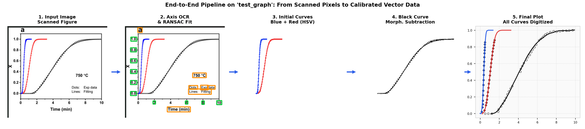
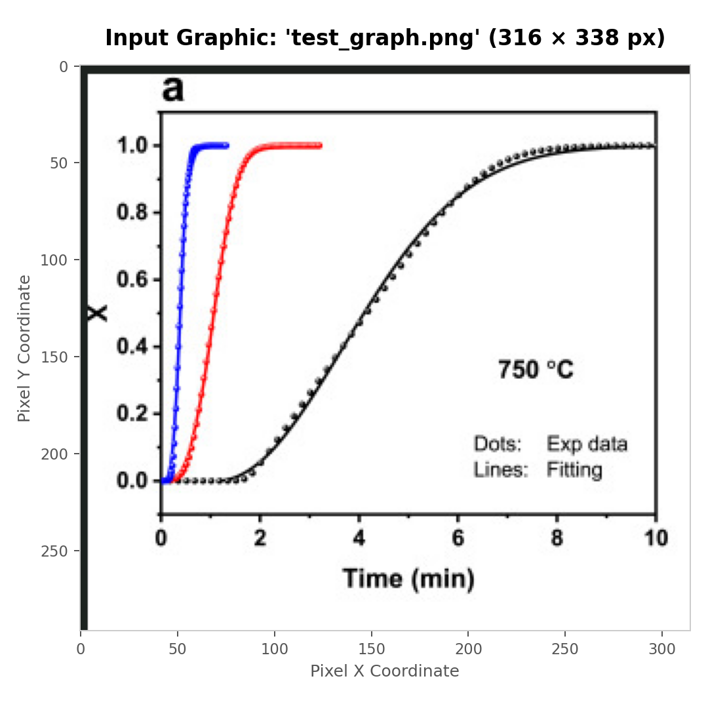
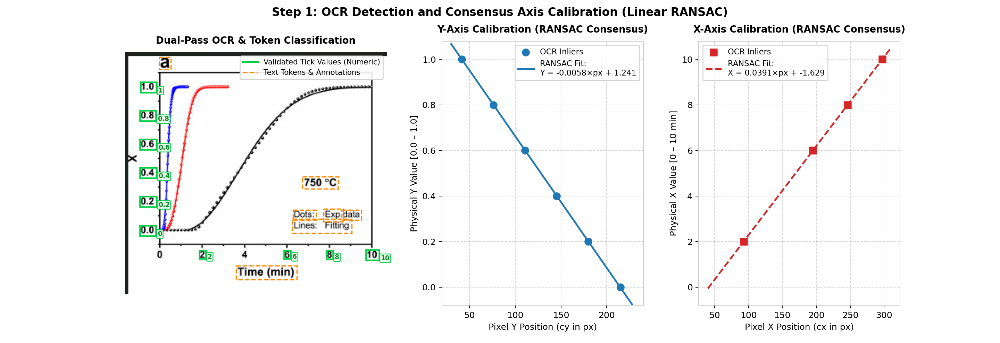
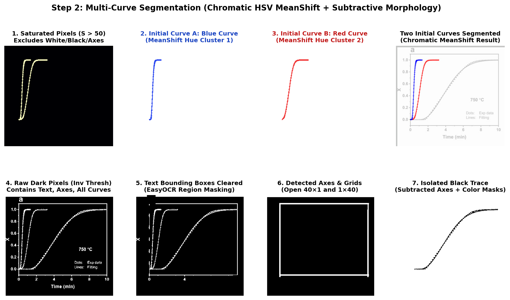
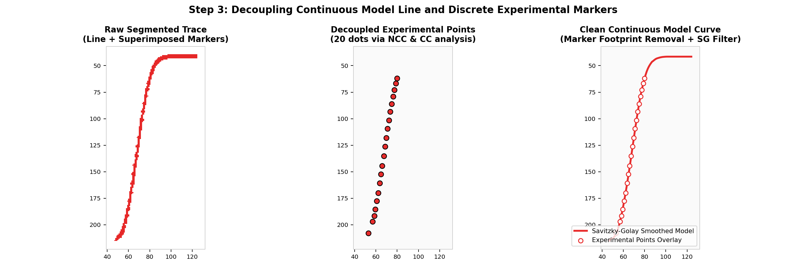
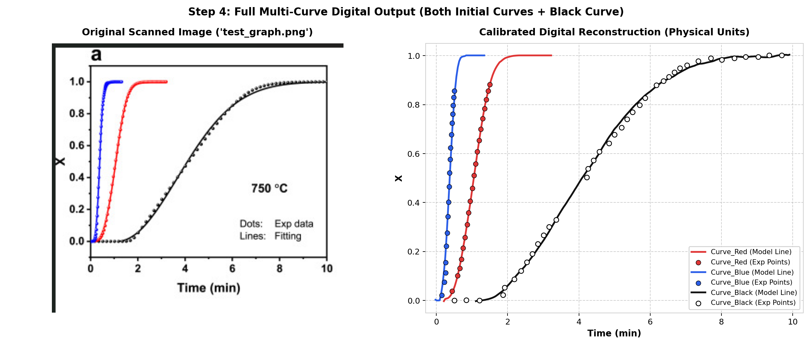
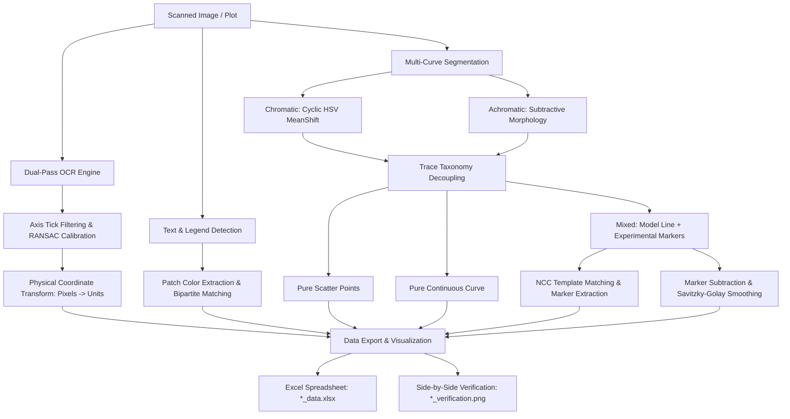

# Automated Experimental Curve Extraction Pipeline

An end-to-end automated computer vision and OCR pipeline in Python designed to extract, calibrate, and digitize scientific plots and experimental curves from scanned figures and publication graphics.

Developed as a Technical Project (2nd Year Engineering Curriculum - Mines Saint-Étienne).

---

## 🌟 Key Highlights

* **100% Fully Automated**: Zero manual intervention. No manual point clicking or hardcoded axis ranges.
* **Intelligent Axis Calibration**:
  * Dual-pass OCR (standard + Otsu binarized) with EasyOCR to detect tick mark values.
  * Robust consensus linear regression (**RANSAC**) with regular step verification to eliminate outlier tick values.
  * Real-unit calibration from pixel coordinates to physical scale ($x, y$).
* **Legend Extraction & Color Matching**:
  * Detects text labels and their adjacent color swatches or marker symbols.
  * Greedy bipartite color matching in RGB Euclidean space between legends and segmented curves.
* **Multi-Curve Segmentation**:
  * **Chromatic curves**: Unsupervised clustering via **MeanShift** on cyclic HSV hue space ($\cos\theta, \sin\theta$) to handle continuous hue wraps.
  * **Achromatic curves**: Subtractive mathematical morphology to extract black/gray curves while eliminating axes, ticks, grid lines, and text.
* **Model vs. Experimental Marker Decoupling**:
  * Differentiates pure scatter plots, pure continuous curves, and mixed curves.
  * For mixed curves (e.g. continuous kinetic model + experimental points):
    * Disconnected marker extraction at onset ($Y=0$).
    * Guided template matching (Normalized Cross-Correlation) to detect markers along the continuous trace.
    * Marker footprint subtraction and boundary-preserving **Savitzky-Golay** smoothing for the continuous model line.
* **Dual Output Generation**:
  * Structured **Excel spreadsheet** (`*_data.xlsx`) with corresponding $X$ and $Y$ columns strictly adjacent.
  * Side-by-side **verification figure** (`*_verification.png`) comparing the original graphic against the reconstructed digitized traces.

---

## 📁 Repository Structure

```text
.
├── main.py                     # Main execution and batch processing script
├── requirements.txt            # Python dependencies and technical specifications
├── README.md                   # Project documentation
├── .gitignore                  # Git ignore rules for Python, cache, and IDEs
│
├── images/                     # Input directory: scanned plots and benchmark figures
│   ├── Curve_points.png
│   ├── Data_points.png
│   ├── image082.png
│   └── test_graph.png
│
├── data/                       # Output directory: extracted spreadsheets and verification plots
│   ├── *_data.xlsx             # Calibrated data tables (adjacent X and Y columns)
│   └── *_verification.png      # Side-by-side visual validation figures
│
├── docs/                       # Technical documentation and visual pipeline explanations
│   ├── explication_technique.pdf
│   └── images/                 # Illustrated step-by-step pipeline figures
│       ├── pipeline_workflow_banner.png
│       ├── step0_input_image.png
│       ├── step1_ocr_calibration.png
│       ├── step2_curve_segmentation.png
│       ├── step3_trace_decoupling.png
│       └── step4_final_reconstruction.png
│
├── presentation/               # Slide decks and generation scripts
│   ├── build_pptx.py           # Automated presentation generator (python-pptx)
│   └── Extraction_automatique_de_courbes_v3.pptx
│
├── scratch/                    # Intermediate test scripts and experimental prototypes
└── archives/                   # Historical code versions and initial prototypes
```

---

## 🚀 Installation & Getting Started

### 1. Prerequisites

* Python **3.9+** (Tested on Python 3.10 to 3.14)
* Recommended: Virtual environment (`venv` or `conda`)

```bash
python -m venv .venv
# On Windows:
.venv\Scripts\activate
# On Linux/macOS:
source .venv/bin/activate
```

### 2. Install Dependencies

```bash
pip install -r requirements.txt
```

### 3. Run the Pipeline

To batch-process all figures inside the default `images/` directory and export results into `data/`:

```bash
python main.py
```

### 4. Custom Directories (CLI Arguments)

You can specify custom input and output folders using the `--input` and `--output` flags:

```bash
python main.py --input path/to/my_images --output path/to/results
```

---

## 🔬 Step-by-Step Pipeline Walkthrough (Benchmark: `test_graph.png`)

To illustrate how the computer vision and OCR engine functions under complex real-world conditions, the complete execution cycle is detailed below on the benchmark figure `images/test_graph.png`.

### 🌐 End-to-End Visual Workflow

The entire data extraction sequence—from raw input pixels through intermediate OCR, morphological filtering, and marker decoupling, to final calibrated vector reconstruction—is summarized below:



---

### Step 0: Raw Graphic Input

* **Input Image**: [`images/test_graph.png`](docs/images/step0_input_image.png) ($316 \times 338$ pixels, RGB).
* **Composition & Challenges**:
  * **Mixed Curves**: Three distinct curves with differing kinetic onsets (fast onset in blue, medium in red, slower sigmoidal transition in black).
  * **Superimposed Data & Models**: Each trace contains both discrete experimental markers (dots) and a continuous theoretical fitting model (lines).
  * **Extraneous Elements**: Text annotations (`750 °C`), panel tags (`a`), and text legends (`Dots: Exp data`, `Lines: Fitting`).
  * **Uncalibrated Pixel Space**: Coordinate axes start at arbitrary image offsets rather than pixel $(0, 0)$.

<p align="center">
  
</p>

---

### Step 1: Intelligent Axis Calibration & OCR (Linear RANSAC)

Converting pixel coordinates $(px, py)$ to physical scientific units ($x, y$) requires locating tick marks and inferring the underlying linear transformation:

1. **Resolution-Aware Scaling & Dual-Pass OCR**:
   * Small figures are scaled dynamically (target dimension $\approx 950\text{ px}$) to prevent interpolation blur while maximizing character readability.
   * `EasyOCR` operates in a two-stage pass: initial grayscale detection followed by an Otsu-binarized fallback if fewer than 3 tick marks are resolved.
2. **Token Classification**:
   * Text bounding boxes are parsed through strict numerical regex matching (`NUMBER_REGEX`) to separate numeric tick labels from non-numeric textual annotations.
3. **Robust Consensus Linear Regression (RANSAC)**:
   * Aligned ticks along the vertical $Y$-axis ($\text{constant } X$) and horizontal $X$-axis ($\text{constant } Y$) are grouped.
   * Exhaustive pair-wise consensus evaluates candidate linear lines ($\text{Value} = a \cdot \text{Pixel} + b$).
   * Outliers (such as spurious ticks or misread digits) are automatically rejected. Regular step spacing ($\Delta \text{pos}$ vs $\Delta \text{val}$) is verified across inliers:
     * **$Y$-Axis Calibration**: $\text{Value} = -0.0058 \cdot y_{px} + 1.241$ ($R^2 = 1.000$, range $[0.0, 1.0]$).
     * **$X$-Axis Calibration**: $\text{Value} = 0.0391 \cdot x_{px} - 1.629$ ($R^2 = 1.000$, range $[0, 10]\text{ min}$).

<p align="center">
  
</p>

---

### Step 2: Multi-Curve Segmentation & Separation

The graphic contains both chromatic curves (colored) and an achromatic curve (black). Standard thresholding cannot isolate the black curve because it shares the same pixel intensity as the axes, grid lines, and text. The pipeline decouples them sequentially:

#### A. Chromatic Segmentation (The Two Initial Curves: Blue & Red)
* Pixels in the HSV color space are filtered by saturation and value ($S > 50, V > 50$), eliminating black axes, grid lines, and white backgrounds.
* Hue is an angular quantity ($0^\circ$ to $180^\circ$ in OpenCV). To avoid artificial boundary splits across the $0^\circ / 180^\circ$ boundary (common in red tones), hue is mapped onto a unit trigonometric circle:
  $$\mathbf{x} = (\cos(2\theta), \sin(2\theta))$$
* **Unsupervised MeanShift Clustering**: Discovers the optimal number of color clusters without requiring the user to specify $K$:
  * **Initial Curve A (Blue)**: Cluster centered at $\text{Hue} \approx 215^\circ$ (582 pixels).
  * **Initial Curve B (Red)**: Cluster centered at $\text{Hue} \approx 0^\circ$ (648 pixels).

#### B. Achromatic Segmentation (Subtractive Morphology for the Black Curve)
The black curve is extracted by subtracting all non-curve elements from the binary dark pixel canvas:
1. **Raw Dark Pixels**: Inverted binary threshold ($\text{threshold} < 150$) capturing all dark elements.
2. **Text Erasure**: Detected OCR text boxes are masked out with zeroed bounding rectangles.
3. **Axis & Grid Suppression**: Morphological opening with directional structuring elements ($40 \times 1$ horizontal and $1 \times 40$ vertical) detects orthogonal grid lines and frame borders, which are dilated and subtracted.
4. **Color Bleed Suppression**: Dilated masks of the chromatic curves are subtracted to eliminate dark anti-aliasing edges from the blue and red lines.
5. **Morphological Filtering**: Connected components within the active plotting area are validated, yielding the isolated **Black Curve** (930 pixels).

<p align="center">
  
</p>

---

### Step 3: Decoupling Continuous Model Lines from Experimental Markers

In scientific publishing, graphics often overlay discrete experimental points (dots/markers) with a continuous theoretical or kinetic fit (solid line). Treating these as a single entity produces stair-stepping or noise. The pipeline decouples them cleanly:

1. **Experimental Marker Detection**:
   * Disconnected markers at curve onset ($Y \approx 0$) are identified via connected component aspect ratio and compactness.
   * **Normalized Cross-Correlation (NCC) Template Matching**: The detected marker profile serves as an adaptive template scanned along the dilated curve trajectory, identifying marker centroid peaks $(\mu_x, \mu_y)$.
2. **Marker Footprint Subtraction**:
   * Detected marker centroids are masked out from the curve canvas with small circular erasures.
3. **Continuous Model Reconstruction**:
   * The remaining curve backbone is sampled by computing column-wise weighted centroids ($\bar{y}$ per $x$).
   * Missing values from erased marker footprints are interpolated.
   * A boundary-preserving **Savitzky-Golay filter** (combined with median filtering) smooths digitizer noise while strictly respecting physical onset and asymptotic bounds.

<p align="center">
  
</p>

---

### Step 4: Calibrated Digital Reconstruction & Final Output

The decoupled pixel coordinates $(px, py)$ for all three curves are mapped to real physical units via the affine matrices from Step 1:
* **The Two Initial Curves (Blue & Red)** and **The Subtracted Black Curve** are completely digitized.
* Both experimental data points (discrete scatter points) and model profiles (smooth continuous lines) are plotted on physical coordinate axes ($X \in [0, 10]\text{ min}$, $Y \in [0, 1.0]$).

<p align="center">
  
</p>

---

## ⚙️ Pipeline Architecture



### Core Algorithmic Decisions:

1. **Axis Calibration & Preprocessing**:
   * Evaluates image resolution, scaling small graphics dynamically to optimize character recognition without introducing interpolation blur.
   * Extracts numeric labels along both vertical and horizontal directions.
   * Runs consensus RANSAC regression to compute the affine mapping matrix while validating step regularity.
   * Graceful fallback to pixel dimensions if axes cannot be resolved.

2. **Legend Identification**:
   * Detects non-numeric textual tokens and scans regions directly to the left for color swatches and marker symbols.
   * Bipartite matching links detected curves to descriptive names with minimal RGB Euclidean distance.

3. **Segmentation & Trace Decoupling**:
   * Hue values are projected onto a 2D trigonometric circle ($\cos\theta, \sin\theta$) to prevent artificial boundary splits between $0^\circ$ and $360^\circ$.
   * Grids and axes are eliminated using directional morphological kernels (`40x1` and `1x40`).
   * Experimental markers are detected using normalized cross-correlation (NCC) and filtered for regular inter-point spacing.
   * Model profiles are reconstructed using Savitzky-Golay filtering constrained within physical bounds.

---

## 📊 Output Format

### Excel Spreadsheets (`*_data.xlsx`)

Every extracted curve is exported with its $X$ coordinates immediately adjacent to its $Y$ coordinates:

| CurveName_Line_X | CurveName_Line_Y | CurveName_Points_X | CurveName_Points_Y |
| :---: | :---: | :---: | :---: |
| 0.00 | 0.000 | 0.00 | 0.000 |
| 1.25 | 0.082 | 2.50 | 0.160 |
| 2.50 | 0.163 | 5.00 | 0.315 |
| ... | ... | ... | ... |

### Visual Control Figures (`*_verification.png`)

A high-resolution side-by-side plot displays:
* **Left**: Original scanned figure.
* **Right**: Digital reconstruction overlay preserving legend names, curve colors, continuous model fits, and experimental points.

---

## 📦 Core Technologies

* **Computer Vision**: [OpenCV (`opencv-python`)](https://opencv.org/)
* **OCR**: [EasyOCR](https://github.com/JaidedAI/EasyOCR)
* **Numerical Computing & Scientific Analysis**: [NumPy](https://numpy.org/), [SciPy](https://scipy.org/)
* **Clustering & Machine Learning**: [scikit-learn](https://scikit-learn.org/)
* **Data Structuring & Export**: [Pandas](https://pandas.pydata.org/), [OpenPyXL](https://openpyxl.readthedocs.io/)
* **Plotting & Visualization**: [Matplotlib](https://matplotlib.org/)

---

## 📄 License

Academic and educational project developed at Mines Saint-Étienne (EMSE). Distributed for research and experimental purposes.
